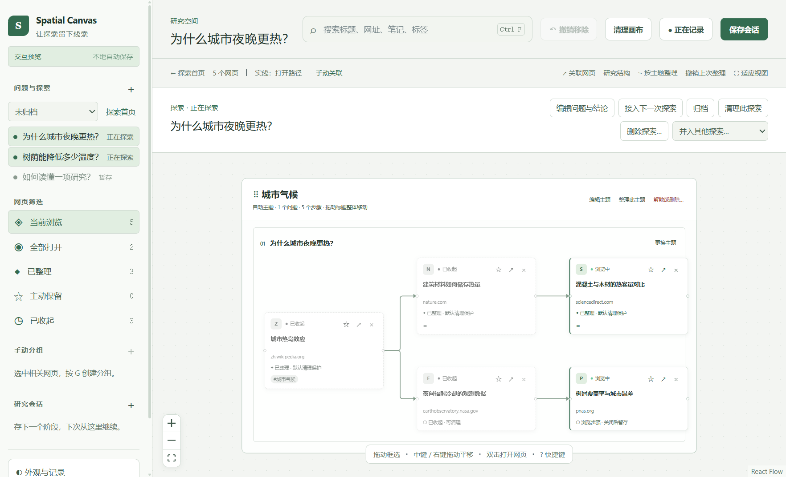

# Spatial Canvas

> 关闭标签页之后，仍能接着查原来的问题。

查资料时，真正容易丢的不是网址，而是“我是怎么走到这里的”。你打开一篇文章，又顺着链接打开几篇比较，临时关掉一部分页面，第二天回来只剩下一堆标签页和浏览器历史，很难判断哪条线索值得继续。

Spatial Canvas 是一个浏览器扩展，把一次网页探索记录成可继续的路径：从一个问题开始，留下页面之间的跳转、来源和分支。首页只显示还在进行的问题；进入后可以看到完整路径。关闭的页面会变成灰色的历史步骤，仍可重新打开；真正的清理由你决定。

它适合：

- 技术调研、产品比较、课程学习和写作准备；
- 一次会打开很多页面、需要来回比较来源的人；
- 今天查到一半，明天还要从原来的问题继续的人。

如果你只是想保存几个网址，书签会更简单。

## 你能用它做什么

- **从问题开始**：先留下这次想弄清楚的事，再打开网页。
- **保留浏览路径**：记录同标签页跳转、新标签页分支和地址栏开启的新探索。
- **继续昨天的探索**：打开画布，先看活跃探索摘要，再进入完整路径。
- **整理重要线索**：给页面写笔记、加标签、分组或建立手动关联。
- **清理临时记录**：没有笔记、标签、分组或手动关联的普通关闭页面可以批量清理；有研究痕迹的内容会被保护，操作可以撤销。
- **带走自己的数据**：随时导出 JSON，升级或换安装来源前先备份。

## 数据和隐私

数据默认只保存在浏览器本地。扩展记录用户主动允许后的网址、标题、图标、标签页关系，以及用户写入的笔记、标签和布局；不读取网页正文、Cookie 或表单内容，也没有账号、服务器和远程行为分析。

第一次打开会先询问是否开始记录。你可以暂停记录，或排除某些网站。没有配置 AI 时，不会发送浏览数据；当前版本也没有接入远程模型。

完整说明见[隐私政策](privacy.html)。

## 安装和使用

当前提供 Chromium 预览包，适用于桌面版 Edge 和 Chrome。

1. 在 [Releases](https://github.com/PseudoPau/spatial-canvas-releases/releases) 下载最新的 `spatial-canvas-*-chromium.zip`。不要下载 GitHub 自动生成的 Source code。
2. 将 ZIP 解压到一个固定目录。
3. 打开 `edge://extensions` 或 `chrome://extensions`，开启“开发人员模式”。
4. 选择“加载解压缩的扩展”，选中含有 `manifest.json` 的解压目录。
5. 点击工具栏里的扩展图标。第一次打开时选择“开始记录”，然后正常浏览。

更新前先在扩展内导出 JSON，再替换目录中的文件并点击“重新加载”。不要先卸载旧扩展，否则本地数据可能随扩展 ID 一起消失。切换到商店版时，也使用导出 / 导入迁移。

## 当前版本

`0.11.0` 是预览版，尚未上架 Edge 或 Chrome 商店。Edge 是主要开发环境；Edge 和 Chrome 的隔离运行流程各通过 15/15 项检查，商店安装、更新和长期运行仍待验证。Safari、Firefox 暂无安装包。

安装包旁边的 `SHA256SUMS` 可用于核对下载文件。安装、升级和反馈方式见[支持页面](support.html)。

## 这个仓库和源码仓库的区别

这个公开仓库只放给使用者的内容：安装包、校验文件、隐私政策、安装与反馈说明、截图和版本发布记录。源码、测试、PRD 和开发过程在[私有源码仓库](https://github.com/PseudoPau/spatial-canvas)。

两者技术上可以合并，但目前分开更清楚：下载者不会在源码、测试夹具和构建文件里找安装包；源码仍可在产品尚未稳定时继续调整；发布包也能独立保留版本和校验记录。未来如果项目准备公开开发，可以把源码仓库改为公开，并让同一个仓库同时管理代码与 Release。

## 反馈

请在 [Issues](https://github.com/PseudoPau/spatial-canvas-releases/issues) 描述浏览器、版本、复现步骤和是否稳定复现。不要贴真实网址、笔记或完整 JSON 备份。
