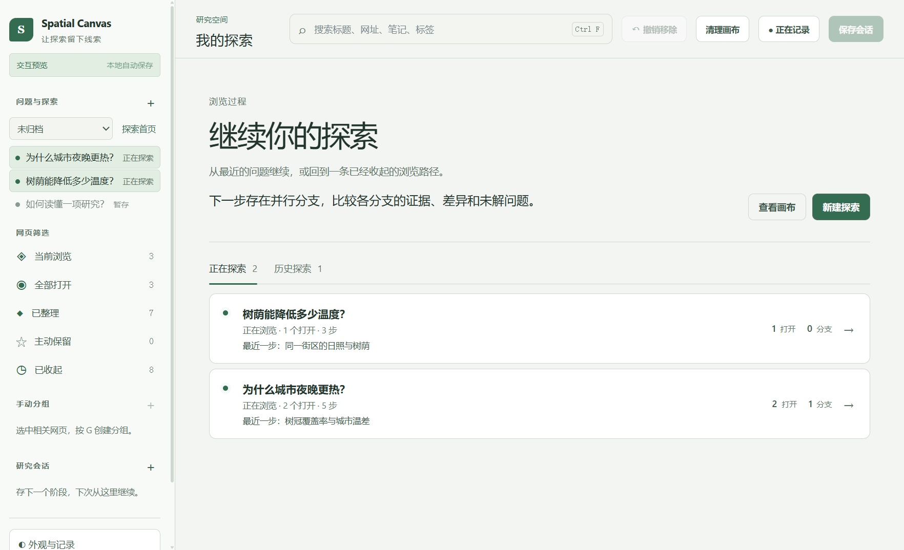

# Spatial Canvas

查资料时，你是不是也不敢关掉标签页，怕关掉以后就接不上了？

比如，你在比较两款相机。从评测点进样张，又从样张查到镜头，再打开几个价格页面。半小时后，浏览器里混着二十多个标签：哪些是在比较画质，哪些只是顺手看的？刚才从哪里岔开了？原来的问题查完了吗？

为了记住这些线索，你把网页一直留着。页面越积越多，找回上下文反而越费劲。隔天再打开，往往得重新看一遍，才能想起查到了哪里。

**Spatial Canvas 是给经常这样查资料的人做的 Edge / Chrome 扩展。它自动把网页跳转记录成路径，让你看见每条线索从哪里来、在哪处分了支，关闭网页后也能沿着原路继续。**

书签保存选中的网址，浏览历史帮助找回访问过的页面。这个工具着重保留页面之间的来路：同一标签页中的连续跳转会留下步骤，从某页打开的新标签会留下分支。你不必边查边建卡片、画连线。

允许记录后，照常浏览即可。迷路时打开画布，沿着路径回到分岔的页面；想暂时停下就关闭网页，步骤会置灰保留。下次从首页找到那次探索，再打开需要的页面。你也可以给探索写一个问题，给关键页面记下判断，减少下次重新阅读的时间。

暂时不用的网页可以关闭，不需要的记录可以清理。清理前能看到范围，并选择保护笔记、标签、分组和手动关联；删除后可以撤销。这样，结束一条岔路也有了明确的操作。

它适合需要反复比较来源的技术调研、选购和写作查资料。当前核心功能免费，使用不需要 AI。路径记录的是网页跳转，你对资料的判断可以留在笔记里。

## 数据和隐私

数据默认只保存在浏览器本地。扩展记录用户主动允许后的网址、标题、图标、标签页关系，以及用户写入的笔记、标签和布局；不读取网页正文、Cookie 或表单内容，也没有账号、服务器和远程行为分析。

第一次打开会先询问是否开始记录。你可以暂停记录，或排除某些网站。当前版本没有接入远程 AI 模型。

完整说明见[隐私政策](https://pseudopau.github.io/spatial-canvas-releases/privacy.html)。

## 安装和使用

当前提供 Chromium 预览包，适用于桌面版 Edge 和 Chrome。

1. 在 [Releases](https://github.com/PseudoPau/spatial-canvas-releases/releases) 下载最新的 `spatial-canvas-*-chromium.zip`。不要下载 GitHub 自动生成的 Source code。
2. 将 ZIP 解压到一个固定目录。
3. 打开 `edge://extensions` 或 `chrome://extensions`，开启“开发人员模式”。
4. 选择“加载解压缩的扩展”，选中含有 `manifest.json` 的解压目录。
5. 点击工具栏里的扩展图标。第一次打开时选择“开始记录”，然后正常浏览。

更新前先在扩展内导出 JSON，再替换目录中的文件并点击“重新加载”。不要先卸载旧扩展，否则本地数据可能随扩展 ID 一起消失。切换到商店版时，也使用导出 / 导入迁移。

## 当前版本

`0.11.0` 是预览版，尚未上架 Edge 或 Chrome 商店。Edge 是主要开发环境；Edge 和 Chrome 的隔离运行流程各通过 15/15 项检查，商店安装、更新和长期运行仍待验证。Safari、Firefox 暂无安装包。

安装包旁边的 `SHA256SUMS` 可用于核对下载文件。安装、升级和反馈方式见[支持页面](https://pseudopau.github.io/spatial-canvas-releases/support.html)。

## 反馈

请在 [Issues](https://github.com/PseudoPau/spatial-canvas-releases/issues) 描述浏览器、版本、复现步骤和是否稳定复现。不要贴真实网址、笔记或完整 JSON 备份。
